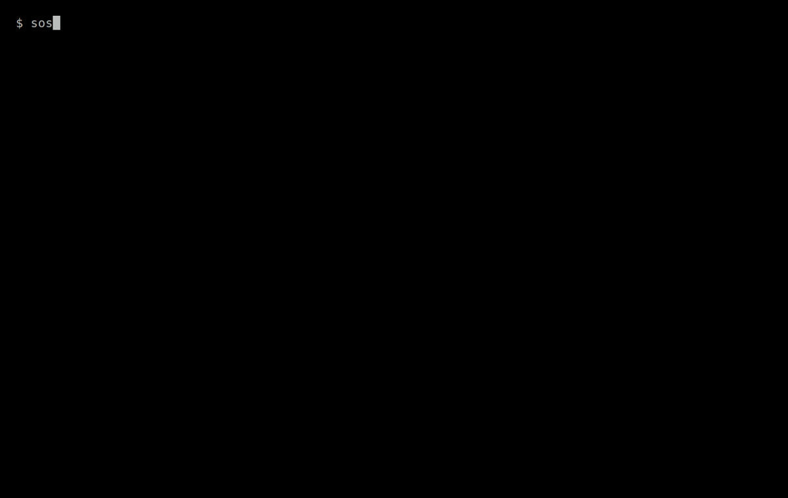

# Sosya

**Describe a hacking lab in plain English. Get it running, isolated and verified.**

> Status: pre-release. Sosya v0.1 ships on November 24, 2026. Until then, install it from the
> repository: `uv tool install git+https://github.com/gabrielemontagnini/sosya`.



Sosya turns one sentence into a working, multi-container security lab (a *range*). An LLM picks
and composes real, documented vulnerable environments from [Vulhub](https://github.com/vulhub/vulhub);
deterministic code starts them on Docker, keeps them off your network and proves that they work.
Its name comes from *sosia*, "the double": your infrastructure's double, built to be broken.

## Quickstart

No API key needed for the ready-made ranges:

```console
$ uv tool install sosya        # or: pipx install sosya
$ sosya up dmz-redis           # Struts2 in a DMZ, Redis only on the internal network
$ sosya shell dmz-redis        # a Kali box inside the range
```

Then describe your own lab. Set `ANTHROPIC_API_KEY`, `OPENAI_API_KEY`, or `OPENAI_BASE_URL` for
any OpenAI-compatible server (LM Studio, vLLM, OpenRouter; tested with Ollama). The description
can be in any language:

```console
$ sosya new "Struts2 app in a DMZ, passwordless Redis reachable only from the web server"
```

`sosya new` shows the plan and asks before it starts anything (`Start this range? [Y/n/edit]`).
When the range is green, `sosya shell` opens the attacker box, `SCENARIO.md` lists the objectives,
hints and flag locations, and `sosya down <range>` removes everything.

### Configuration

| Setting | What it does |
| --- | --- |
| `ANTHROPIC_API_KEY` | Use Anthropic (`ANTHROPIC_BASE_URL` for another endpoint) |
| `OPENAI_API_KEY`, `OPENAI_BASE_URL` | Use OpenAI or any OpenAI-compatible server |
| `SOSYA_PROVIDER` | `anthropic` or `openai`, when keys for both are set |
| `--model` / `SOSYA_MODEL` | The model id. Required for OpenAI and for servers that list several models |
| `--effort` / `SOSYA_EFFORT` | `low`, `medium` (default), `high`, `xhigh` or `max`; OpenAI-compatible servers get `high` for the last two |

Without a model id, Sosya chooses one automatically: the newest mid-tier model on Anthropic, or
the only model a server lists (a local Ollama with one model pulled, for example). Keys are never
printed or logged.

### Requirements

- Docker Engine 28 or newer with Docker Compose v2 (`sosya doctor` checks both). Version 28 is
  needed for the isolated gateway mode of internal networks.
- Python 3.12 or newer.
- Tested on Linux (x86_64). macOS with Docker Desktop should work but is **not verified yet**:
  if you try it, please [open an issue](https://github.com/gabrielemontagnini/sosya/issues) with
  the output of `sosya doctor`. On Apple Silicon, nearly every Vulhub image is amd64 only and
  runs under emulation, so it is slower, and Java applications (Jenkins, Solr, Struts2) can take
  minutes to start.

## How it works

```
sentence → catalog search → LLM planner → range.yaml (you approve it)
         → renderer → docker compose → validation → ready range + SCENARIO.md + flags
                                            │
                    failures go back to the planner, at most 3 attempts in all
```

- **The LLM only plans.** It writes a `range.yaml` from at most 25 catalog candidates. The file is
  checked with a strict schema and against the catalog. Rendering, starting and validating are
  plain code and never call the LLM.
- **Validation is live.** Every service must run; the attacker box must reach every service it
  shares a network with; every target must be able to connect back to the attacker box (what a
  reverse shell or a JNDI callback needs); segmentation, no internet for targets, nothing
  reachable from the host, and the flags are all checked.
- **Visible repair loop.** Schema errors and failed checks go back to the planner with the logs,
  at most 3 attempts in all, one line per step on screen.
- **Shareable.** A `range.yaml` runs anywhere with `sosya up`, with no LLM.
- **No exploits.** Sosya composes public, documented images. `SCENARIO.md` gives objectives,
  progressive hints and links to the CVEs, not attack steps.

### Honest numbers

- **11 seconds with a hosted model**, from the sentence to a verified two-host range, with the
  images already pulled.
- **About 1 to 4 minutes** the first time, mostly image pulls (71 s median, 240 s p90 over the ten
  [Gate 2 prompts](https://github.com/gabrielemontagnini/sosya/blob/main/evals/gate2.yaml): 10 of
  10 green).
- **Local models work, slowly.** An 8B model on CPU (no GPU) needs about 10 minutes per plan, and
  10 to 15 minutes for a single-host range. Keep the default effort: lower settings are not
  reliable at that size.

## Gallery

Seven ranges ship inside the package. Start any of them with `sosya up <name>`, no key needed.
Each one is validated live every week.

| Range | What is inside |
| --- | --- |
| `dmz-redis` | Struts2 in a DMZ; a passwordless Redis reachable only through the web server (pivot) |
| `wordpress` | An old WordPress blog, with its MySQL database kept private |
| `solr` | An Apache Solr search server; the way in needs a callback to the attacker box |
| `grafana` | A Grafana dashboard server open to anonymous visitors |
| `drupal` | A Drupal 8 site, installed and never patched |
| `file-server` | A Samba file server in a DMZ; an SSH server reachable only from it (pivot) |
| `jenkins` | A Jenkins CI/CD server with anonymous read access |

The range files are in
[`src/sosya/gallery/`](https://github.com/gabrielemontagnini/sosya/tree/main/src/sosya/gallery).

## Security model

Isolation is the default, not an option:

- **No published ports.** Targets live on Docker networks with `internal: true` and the
  `isolated` gateway mode: the host has no route to them, and the attacker box is the only way
  in.
- **Targets never join a network with internet access.** The attacker box has one, unless the
  range sets `attacker.internet: false` in its `range.yaml`. With `--proxy` or `--expose`, the
  relay container has one too: it only forwards what is published on `127.0.0.1` to the
  attacker box, and joins no segment.
- **Pivots are real.** A host on two networks is the only path between them.
- **`--expose` and `--proxy` bind `127.0.0.1` only**, through a relay on a separate network that
  no target joins. `sosya up --proxy` gives your host browser or Burp a SOCKS5 proxy that reaches
  exactly what the attacker box reaches.
- **Dangerous environments need consent.** The two Vulhub environments that need host-level
  privileges (`privileged: true`) start only with `--allow-privileged` and an interactive
  confirmation that lists each one.
- **MCP rules.** Over MCP, dangerous environments are always refused, with no override.
  `attacker_exec` runs commands only in ranges with `attacker.internet: false`, so an agent
  never gets a box with internet access.
- `sosya validate` re-checks all of this on a running range; CI runs the same checks.

**The limit, stated plainly.** Containers share the host's kernel. Docker isolation is not a
virtual machine: a container escape stays possible, through a kernel bug or a misconfiguration.
For sensitive labs, run Sosya on a dedicated machine or in a VM. Dangerous environments make an
escape trivial by design, and that is why they ask for consent.

Design decisions and the measurements behind them are in
[`docs/architecture.md`](https://github.com/gabrielemontagnini/sosya/blob/main/docs/architecture.md).

## For AI agents: `sosya mcp`

`sosya mcp` is an MCP server on stdio. It works with any MCP client. A typical configuration:

```json
{
  "mcpServers": {
    "sosya": { "command": "sosya", "args": ["mcp"] }
  }
}
```

Tools: `catalog_search`, `check_range`, `up`, `status`, `validate`, `scenario`, `down`,
`attacker_exec`, `check_flag`, and `new` when an LLM provider is configured.

An agent can act as the planner itself, with no LLM key:

1. `catalog_search` for the environments it needs;
2. write a `range.yaml`, then `check_range` until it has no errors;
3. `up`, `validate` and `scenario`;
4. `check_flag` to confirm a captured flag without revealing it, then `down`.

The server keeps its ranges in `$XDG_STATE_HOME/sosya` (`~/.local/state/sosya`), or in
`--workspace` / `SOSYA_WORKSPACE`. `sosya status` and `sosya down` see them from anywhere.

## Commands

| Command | What it does |
| --- | --- |
| `sosya new "<description>"` | Plan with the LLM, show the plan, ask, build and validate |
| `sosya up <range>` | Start a range from its `range.yaml`, no LLM; `--proxy`, `--expose` |
| `sosya shell [range]` | Open a shell in the Kali attacker box (the only running range by default) |
| `sosya validate <range>` | Re-run every check on a running range |
| `sosya status` | List running ranges and the health of their services |
| `sosya down <range>` | Stop a range and remove its containers and networks |
| `sosya catalog [query]...` | Search the 334 Vulhub environments |
| `sosya mcp` | Start the MCP server on stdio |
| `sosya doctor` | Check Docker, Compose, CPU architecture and LLM configuration |

## How Sosya compares

- **Vulhub, used directly.** Vulhub is the source of every Sosya environment, and an excellent
  one: hundreds of documented, reproducible vulnerabilities, each started with one
  `docker compose up`. It is designed for one environment at a time on an isolated test machine,
  where publishing ports on every interface is not a problem. Sosya adds what a shared or
  everyday machine needs on top: several environments composed into one topology, no ports on
  the host, an attacker box inside the range, live validation and scenarios with flags.
- **VM-based ranges, such as [Ludus](https://docs.ludus.cloud/).** Ludus builds full virtual
  machines on Proxmox with Packer and Ansible, so it can model far more than containers can, at
  the cost of a dedicated server (its documentation asks for at least 32 GB of RAM and 50 GB of
  disk per range) and VM build times. Sosya runs on a laptop with Docker, in seconds, and stays
  within what Linux containers can run.

## Roadmap

v0.1 is Docker Compose and Linux containers only. Under consideration for v0.2, tracked as issues:

- control of the thinking mode of local models, to make small models on CPU faster;
- Docker Desktop on macOS, verified;
- clearer marks in the catalog for environments that are broken upstream;
- automatic detection of published ports that never listen.

Out of scope: VMs, Windows and Active Directory, a web UI, exploit generation, multi-user or
hosted modes.

## Responsible use

Sosya builds local labs for training and research on systems you own. It does not generate or run
exploits.

## Credits

Vulnerable environments by [Vulhub](https://github.com/vulhub/vulhub), MIT license, pinned at
commit [`9b90d42`](https://github.com/vulhub/vulhub/tree/9b90d4276f84feed6333286afeb7e1250379a1da).
Thank you to the Vulhub maintainers and contributors.

## License

[MIT](https://github.com/gabrielemontagnini/sosya/blob/main/LICENSE)
